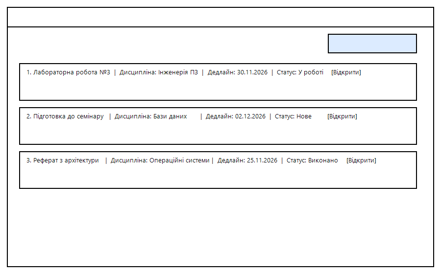
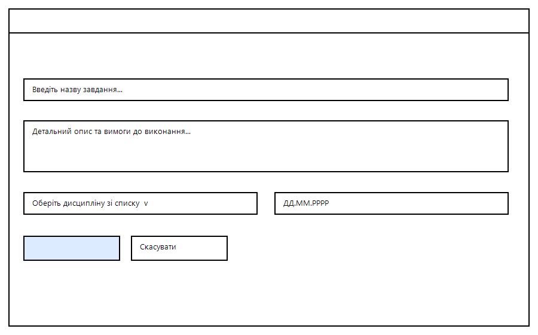
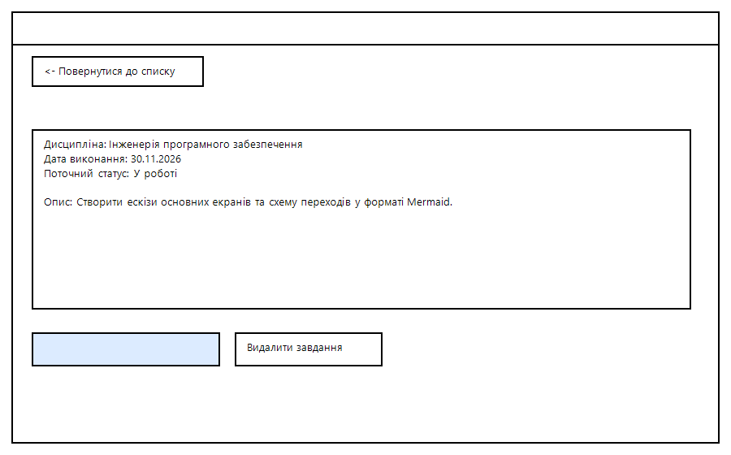

# Ескізи основних екранів

## Назва програмного продукту

Student Task Manager

## Основний сценарій

Студент відкриває головний екран зі списком навчальних завдань, створює нове завдання через форму додавання та переглядає збережену картку завдання.

## Перелік екранів

1. Список завдань (`Головний екран`).
2. Створення завдання (`Форма додавання`).
3. Перегляд завдання (`Картка завдання`).

---

## Екран 1. Список завдань

### Призначення

Головний екран відображає всі навчальні завдання студента з їхніми дисциплінами, дедлайнами та статусами, а також дозволяє перейти до створення нового або перегляду наявного завдання.

### Основні елементи

- заголовок продукту «Student Task Manager» та заголовок сторінки «Мої навчальні завдання»;
- кнопка «+ Додати завдання»;
- список карток/рядків завдань (назва, навчальна дисципліна, дата виконання, статус);
- кнопка «Відкрити» біля кожного завдання.

### Основна дія

Користувач натискає кнопку «+ Додати завдання».

### Перехід

Після натискання кнопки «+ Додати завдання» відкривається екран створення нового завдання. При натисканні «Відкрити» здійснюється перехід на екран перегляду обраного завдання.



---

## Екран 2. Створення завдання

### Призначення

Екран дозволяє студенту ввести необхідні дані для створення нового навчального завдання.

### Основні елементи

- заголовок «Нове навчальне завдання»;
- поле введення «Назва завдання» (обов’язкове);
- багаторядкове поле «Опис завдання»;
- випадаючий список «Навчальна дисципліна» (обов’язковий);
- поле вибору дати «Дата виконання (дедлайн)» (обов’язкове);
- головна кнопка «Зберегти»;
- другорядна кнопка «Скасувати».

### Основна дія

Користувач заповнює поля форми та натискає кнопку «Зберегти».

### Перехід

Після успішного збереження відкривається екран перегляду створеного завдання. У разі натискання кнопки «Скасувати» дані не зберігаються і користувач повертається на екран зі списком завдань.



---

## Екран 3. Перегляд завдання

### Призначення

Екран показує детальну інформацію про створене або вибране завдання та дозволяє керувати його станом.

### Основні елементи

- кнопка «<- Повернутися до списку»;
- заголовок із назвою завдання;
- блок інформації (навчальна дисципліна, дата виконання, поточний статус, повний опис);
- головна кнопка «Позначити виконаним» (зміна статусу `FR-03`);
- кнопка «Видалити завдання» (`FR-04`).

### Основна дія

Користувач перевіряє збережену інформацію про завдання та за потреби змінює його статус.

### Перехід

Натискання кнопки «<- Повернутися до списку» повертає користувача на головний екран зі списком завдань.



---

## Логіка та схема переходів між екранами

### Таблиця переходів

| Поточний екран | Дія користувача | Наступний екран |
| :--- | :--- | :--- |
| Список завдань | Натискає «+ Додати завдання» | Створення завдання |
| Список завдань | Натискає «Відкрити» біля завдання | Перегляд завдання |
| Створення завдання | Натискає «Зберегти» (дані валідні) | Перегляд завдання |
| Створення завдання | Натискає «Скасувати» | Список завдань |
| Перегляд завдання | Натискає «<- Повернутися до списку» | Список завдань |
| Перегляд завдання | Натискає «Видалити завдання» | Список завдань |

### Схема переходів (Mermaid)

```mermaid
flowchart TD
    A[Список завдань] -->|Натискає '+ Додати завдання'| B[Створення завдання]
    A -->|Натискає 'Відкрити'| C[Перегляд завдання]
    B -->|Натискає 'Зберегти'| C
    B -->|Натискає 'Скасувати'| A
    C -->|Натискає '<- Повернутися до списку'| A
    C -->|Натискає 'Видалити завдання'| A